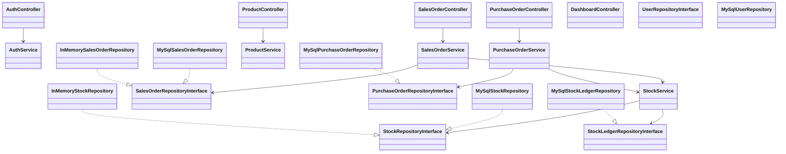

# Software Design Document (SDD)
## Inventory & Order Management System

**Source of truth:** Intermediate Programmer - Final Project Brief, Participant Guide Edisi 1.0, Oktober 2026.  
**Target implementation:** PHP 8.2+ Native OOP, MySQL 8, HTML/CSS, Vanilla JavaScript + Fetch API, Docker Compose, PHPUnit, static analysis.  
**Audience:** Developer / Codex agent / assessor.  
**Status:** Implementation-ready baseline.

---

## 1. Purpose

Dokumen ini menerjemahkan project brief menjadi rancangan software yang dapat langsung digunakan sebagai kontrak implementasi. Fokusnya adalah memenuhi seluruh requirement wajib dengan arsitektur pragmatis, dapat diuji, concurrency-safe untuk stok, dan mudah dipertahankan saat technical defense.

Prinsip utama:

1. Jangan menambah kompleksitas yang tidak diminta.
2. Business rule berada di Service, bukan di Controller, view, atau JavaScript.
3. Akses data berada di Repository dengan PDO prepared statement.
4. Boundary repository memakai interface untuk mendukung Dependency Inversion dan unit test dengan fake/in-memory implementation.
5. Semua perubahan stok hanya lewat stock operation service yang menulis `stock_ledger` dan memperbarui `product_stocks` dalam transaksi yang sama.
6. Authorization ditegakkan di server.
7. Dashboard/report mengambil angka dari query nyata/agregasi, bukan hardcoded.
8. Semua keputusan yang signifikan harus dapat dilacak ke requirement ID dan evidence.

---

## 2. Scope

### 2.1 In scope

- Authentication: login, session, logout.
- User management untuk Admin, Sales, Warehouse Staff.
- Master data: category, product, warehouse, supplier, customer.
- Multi-warehouse stock.
- Purchase Order dan partial/full goods receipt.
- Sales Order, submission, approval/rejection/cancellation, goods issue/fulfillment.
- Stock ledger.
- Search, filter, sort, pagination.
- Role-based dashboard.
- CSV report.
- Minimal satu JSON API.
- Validation dan safe error handling.
- Responsive UI.
- Dockerized application + MySQL.
- Scheduled/manual low-stock script.
- Unit tests, integration tests, static analysis.
- Architecture artifacts: ERD, initial/as-built class diagram, ADR, refactor log, SRP audit, tech debt, critique.
- AI usage log.

### 2.2 Out of scope

Jangan implementasikan kecuali semua requirement wajib stabil:

- Microservices.
- Message queue production.
- Cloud deployment.
- Kubernetes.
- Mobile application.
- Real-time notification.
- Automated cron scheduler di server penilaian.
- Full automated E2E suite.
- Frontend framework, CSS framework, backend framework, ORM, framework DI container.

---

## 3. Technology Constraints

| Area | Wajib | Tidak boleh |
|---|---|---|
| Frontend | HTML semantik, CSS buatan sendiri, Vanilla JS, Fetch API | React, Vue, Angular, jQuery, CSS framework, admin template siap pakai |
| Backend | PHP 8.2+ Native OOP, Controller-Service-Repository, constructor injection | Laravel, CodeIgniter, Symfony, Slim, ORM, CRUD generator, framework DI container |
| Database | MySQL 8, PDO prepared statement, FK, constraints, indexes, explicit transactions | NoSQL utama, raw string concatenation untuk input user |
| Runtime | Dockerfile, Docker Compose, `.env.example` | Setup yang hanya bekerja di komputer peserta |
| Testing | PHPUnit unit + integration, static analysis | Trivial getter/setter tests, skipped-only tests |

Composer diperbolehkan untuk autoload dan dev dependencies.

---

## 4. Actors and Authorization Matrix

### 4.1 Roles

- `Admin`
- `Sales`
- `WarehouseStaff`

### 4.2 Authorization rules

| Capability | Admin | Sales | Warehouse Staff |
|---|---:|---:|---:|
| Login/logout/profile | Yes | Yes | Yes |
| Manage users | Yes | No | No |
| Manage master data | Yes | Read catalog | Read product + stock |
| Create Sales Order | Yes | Yes, own | No |
| Submit Sales Order | Yes | Yes, own | No |
| Approve/reject Sales Order | Yes | No | No |
| Create Purchase Order | Yes | No | Yes / propose |
| Goods receipt | Yes | No | Yes |
| Goods issue | Yes | No | Yes |
| Dashboard | Global | Own orders | Stock & fulfillment |
| CSV report | Global | Own orders | Stock report |
| Price lists (D-19/ADR-025, user decision) | Manage | No (price API only) | No |
| Quotations (D-19) | All | Own | No |
| Delivery notes / surat jalan (D-19) | All | Own SOs, read | All, created by issue |
| Invoices, payments, void, AR reports (D-19) | Yes | Own SOs' invoices, read | No |
| Inventory valuation, reconciliation, gross margin, losses, COGS/margin panels (D-20/ADR-026, user decision) | Yes | No (403) | No (403; lot unit costs stay visible where ADR-023/024 show them) |

### 4.3 Segregation of duties

Server MUST reject approval attempts from Sales, even if endpoint is called manually. UI hiding is not sufficient. Authorization rule must be tested independently from frontend.

---

## 5. Core Business Workflows

### 5.1 Authentication

```text
Anonymous -> POST login -> validate credentials/status -> regenerate session ID
          -> store authenticated user identity + role -> role dashboard
Authenticated -> logout -> clear auth session -> anonymous
```

Security rules:

- `password_hash()` for storage.
- `password_verify()` for login.
- Generic invalid credential message.
- Inactive user cannot login.
- Protected pages/API require authenticated session.
- Unauthorized operation returns 403 or equivalent safe response.

### 5.2 Purchase Order

```text
Draft -> Ordered -> PartiallyReceived -> Received
  |         |              |
  +---------+--------------+-> Cancelled (only when business rules allow)
```

Receipt behavior:

1. Verify actor may receive PO.
2. Verify PO status permits receipt.
3. Validate each received quantity > 0 and <= remaining quantity.
4. Begin DB transaction.
5. Lock target `product_stocks` rows for `(product_id, warehouse_id)`.
6. Update/increment stock.
7. Insert `stock_ledger` row type `Receipt` per stock movement.
8. Update received quantity per PO item.
9. Recalculate PO status (`PartiallyReceived` or `Received`).
10. Commit.
11. Roll back on any failure.

### 5.3 Sales Order

```text
Draft -> PendingApproval -> Approved -> Fulfilled
  |             |              |
  +-------------+--------------+-> Cancelled before Fulfilled
```

As built with partial fulfilment (D-14/ADR-020, **user decision outside the brief's SO status set**, not a trainer
decision):

```text
Draft -> PendingApproval -> Approved --issue all remaining--> Fulfilled
  |             |              |  \
  |             |              |   --issue part--> PartiallyFulfilled --issue part--> PartiallyFulfilled
  |             |              |                        |      \
  |             |              |                        |       --issue all remaining--> Fulfilled
  |             |              |                        +--close remaining (Admin, reason)--> PartiallyFulfilled + closure
  +-------------+--------------+-> Cancelled   (PartiallyFulfilled can NOT be cancelled; close the remainder instead)
```

Rules:

- Sales may only manage own Sales Orders.
- Sales cannot approve/reject.
- Only Admin approves/rejects.
- Goods issue only from `Approved` or `PartiallyFulfilled` (D-14/ADR-020) while the remainder is not closed.
- Goods issue fails if available stock insufficient.
- Fulfilled only after successful issue for all items (possibly over several shipments).
- Partial fulfilment (D-14/ADR-020, user decision outside the brief): Warehouse/Admin enter per-line quantities 0..remaining (at least one above 0, else 422); one transaction per shipment; status becomes `Fulfilled` when every line is complete, otherwise `PartiallyFulfilled`. Admin may close the unshipped remainder of a `PartiallyFulfilled` order with a mandatory reason (`sales_order_closures`); the remaining reservation is released, the status stays `PartiallyFulfilled` and no further issue is accepted. Closing an `Approved` order with nothing shipped is refused (cancel it instead). Cancelling a `PartiallyFulfilled` order is refused.
- Stock reservation (D-12/ADR-018, user decision, not trainer): approval reserves every line at the source warehouse and is refused with 422 "Insufficient available stock" when any line exceeds `quantity − reserved_quantity`; issue consumes the reservation; cancelling an Approved order releases it. Draft/PendingApproval orders (including rejection) hold no reservation.
- Negotiated line prices (D-13/ADR-019, user decision, not trainer): the master selling price is the default; a different price needs a reason (3–255 characters), may not be below the product's current purchase price, and Sales may discount at most `SALES_MAX_DISCOUNT_PERCENT` (default 10) below master (Admin uncapped; above master allowed with a reason). The approver sees master price, difference and reason per line and a summary notice above Approve.

### 5.4 Concurrency-safe goods issue

Chosen baseline mechanism: **transaction + `SELECT ... FOR UPDATE` row locking** on the relevant `product_stocks` rows.

Pseudo-flow:

```text
BEGIN
SELECT quantity
FROM product_stocks
WHERE product_id = :product AND warehouse_id = :warehouse
FOR UPDATE;

IF quantity < issue_qty:
    ROLLBACK
    throw InsufficientStock

UPDATE product_stocks
SET quantity = quantity - :issue_qty
WHERE product_id = :product AND warehouse_id = :warehouse;

INSERT INTO stock_ledger(..., movement_type='Issue', quantity=:issue_qty, ...);
...
COMMIT
```

Why this design:

- Two competing issues serialize on the same stock row.
- The second transaction reads the post-commit quantity after acquiring the lock.
- Oversell is prevented without distributed infrastructure.
- Mechanism is explainable and testable in MySQL/InnoDB.

Do not update stock from UI/controller/repository ad hoc.

Stock reservation (D-12/ADR-018, user decision). `product_stocks.reserved_quantity` holds the stock committed to Approved sales orders; available = quantity − reserved_quantity, enforced by `CHECK (reserved_quantity <= quantity)`. All changes run through `StockService` in one transaction with the source order locked first (ADR-004) and the stock rows locked `FOR UPDATE` in product order:

```text
Approve (PendingApproval -> Approved): lock SO; lock rows; require quantity - reserved >= qty for every line
                                       (else 422, nothing changed); reserved += qty; status Approved;
                                       audit sales-orders.approve {reserved_units, reservation[]}. No ledger row.
Issue   (Approved|PartiallyFulfilled -> PartiallyFulfilled|Fulfilled, one shipment, D-14/ADR-020):
                                       lock SO; replay check (hash over per-line quantities); closure/state check;
                                       qty <= remaining per line; lock rows; require quantity >= qty and reserved >= qty;
                                       one UPDATE per line: quantity -= qty, reserved -= qty; one Issue ledger row per
                                       line; issued_quantity += qty; status; audit sales-orders.issue {shipment_units,
                                       remaining_units, status_after, shipment[]}.
Close remaining (PartiallyFulfilled, Admin, reason): lock SO; lock rows; reserved -= remaining per line; closure row;
                                       audit sales-orders.close-remainder. No ledger row; status unchanged.
Cancel  (Approved -> Cancelled):       lock SO; lock rows; reserved -= qty; audit sales-orders.cancel. No ledger row.
Other decreases (adjustment, transfer dispatch, supplier return, unreserved issue): refused (422) when the result would
                                       be below reserved_quantity. Increases (incl. transfer receipt) are unaffected.
```

Invariants: `quantity = Σ ledger` (unchanged, reservations are not movements) and, per pair, `reserved_quantity = Σ (quantity − issued_quantity) of the lines of Approved and PartiallyFulfilled SOs from that warehouse whose remainder is not closed` (`StockReservationReconciler::MISMATCHES`, D-14 formula). Per SO line `issued_quantity = Σ Issue ledger rows`, and `Fulfilled ⇔ every line complete` (`PartialFulfilmentChecks`).

---

## 6. Domain Model

### 6.1 User

Fields:

- id
- name
- email unique
- password_hash
- role enum: `Admin`, `Sales`, `WarehouseStaff`
- is_active
- created_at
- updated_at

### 6.2 Warehouse

- id
- name
- location
- is_active
- timestamps

### 6.3 Category

- id
- name
- description nullable
- timestamps

### 6.4 Product

- id
- sku unique
- name
- category_id
- unit (base unit code: the smallest unit, factor 1; D-16/ADR-022, user decision)
- purchase_price >= 0 (per base unit)
- selling_price >= 0 (per base unit)
- reorder_point >= 0 (base units)
- tracks_expiry (D-17/ADR-023, user decision): every new lot needs an expiry date (migrated `LEGACY` lots excepted)
- units (`product_units`, D-16/ADR-022): exactly one base unit (factor 1, code = `unit`) plus optional larger units (factor ≥ 2, e.g. box 12, karton 48), each with optional barcode (unique) and own master prices per unit (null = base price × factor); at most one purchase default and one sales default; inactive units are never defaults
- image_path nullable
- is_active
- timestamps

### 6.5 ProductStock

- id
- product_id
- warehouse_id
- quantity >= 0 (physical stock in base units, = Σ ledger)
- reserved_quantity >= 0, <= quantity (held for Approved sales orders; available = quantity − reserved_quantity; D-12/ADR-018, user decision)
- reorder_point_override nullable, >= 0 (per-warehouse reorder point; null = product default; D-10/ADR-016, user decision)
- lot_count (D-17/ADR-023): number of lots of the pair; the pair row is the lock root of its lots
- updated_at
- unique `(product_id, warehouse_id)`

### 6.5a StockLot (D-17/ADR-023, user decision)

- id, product_id + warehouse_id (FK to the pair), lot_seq (1..lot_count, unique per pair)
- lot_code (1–60 printable characters; `LEGACY` = migrated stock), expiry_date nullable, received_at (first receipt)
- unit_cost per base unit (whole cents), quantity (base units), opening_quantity (LEGACY only), source_type/source_id
- identity unique `(product, warehouse, lot_code, COALESCE(expiry, 9999-12-31), unit_cost)`; same identity merges
- invariants: Σ lots = pair quantity; lot quantity = opening + Σ ledger rows with its lot_id; expired when expiry < today in `APP_TIMEZONE`; available = quantity − expired − reserved

### 6.6 Supplier / Customer

- id
- name
- contact
- address
- is_active
- timestamps
- customer only (D-19/ADR-025, user decision): price_list_id nullable (one customer price list), optional tax identity npwp (15/16 digits, CHECK), nik (16 digits, CHECK), tax_name, tax_address — snapshotted on invoices

### 6.7 PurchaseOrder

- id
- order_number unique, server-assigned `PO-YYMM-NNNN` (D-11/ADR-017, user decision)
- supplier_id
- destination_warehouse_id
- status enum: `Draft`, `Ordered`, `PartiallyReceived`, `Received`, `Cancelled`
- order_date
- created_by
- timestamps

### 6.8 PurchaseOrderItem

- id
- purchase_order_id
- product_id
- quantity > 0
- received_quantity >= 0
- purchase_price >= 0 (effective line price; defaults to the product master, may be negotiated with a reason, D-13/ADR-019)
- list_price >= 0 (master purchase price snapshot taken by the server at creation, never from the client)
- price_reason nullable, 3–255 characters; required exactly when purchase_price ≠ list_price (CHECK)
- unit_code, unit_factor, unit_quantity (D-16/ADR-022): unit snapshot as entered; quantity and received_quantity are base units; purchase_price and list_price are per entered unit; line total = unit_quantity × purchase_price

Invariants: `received_quantity <= quantity`; `quantity = unit_quantity × unit_factor`; `received_quantity` is a whole number of line units (CHECK `MOD(received_quantity, unit_factor) = 0`).

### 6.9 SalesOrder

- id
- order_number unique, server-assigned `SO-YYMM-NNNN` (D-11/ADR-017, user decision)
- customer_id
- source_warehouse_id
- status enum: `Draft`, `PendingApproval`, `Approved`, `PartiallyFulfilled` (D-14/ADR-020, user decision outside the brief), `Fulfilled`, `Cancelled`
- closure (optional, `sales_order_closures`): reason, closed_by, closed_units, created_at — remaining fulfilment closed
- order_date
- created_by
- approved_by nullable
- approved_at nullable
- timestamps

### 6.10 SalesOrderItem

- id
- sales_order_id
- product_id
- quantity > 0
- selling_price >= 0 (effective line price; defaults to the product master, may be negotiated with a reason, D-13/ADR-019; never below the product purchase price, Sales discount cap)
- list_price >= 0 (master selling price snapshot taken by the server at creation, never from the client)
- price_reason nullable, 3–255 characters; required exactly when selling_price ≠ list_price (CHECK)
- issued_quantity >= 0, CHECK issued_quantity <= quantity (units issued over all shipments, D-14/ADR-020); remaining = quantity − issued_quantity
- unit_code, unit_factor, unit_quantity (D-16/ADR-022): unit snapshot as entered; quantity/issued_quantity are base units; selling_price/list_price are per entered unit (cost floor per unit = base purchase price × factor); line total = unit_quantity × selling_price; CHECK `quantity = unit_quantity × unit_factor` and `MOD(issued_quantity, unit_factor) = 0`
- price_source `MASTER` | `PRICE_LIST`, price_list_id (set exactly for PRICE_LIST, CHECK), quotation_item_id nullable UNIQUE (D-19/ADR-025): since D-19 `list_price` is the **resolved** price (customer price list tier, else master) and the ADR-019 rules are measured against it; a converted line names its quotation line

### 6.11 StockLedger

- id
- product_id
- warehouse_id
- movement_type enum: `Receipt`, `Issue`, `Adjustment`
- quantity > 0
- reference_type (`PO`, `SO`, optional `ADJUSTMENT`)
- reference_id
- performed_by
- created_at
- lot_id (D-17/ADR-023)
- unit_cost, cost_amount (D-20/ADR-026, user decision): set exactly when lot_id is set; cost_amount = signed quantity × lot unit cost in whole cents (CHECK `chk_stock_ledger_cost`); NULL for rows before the valuation start (the ADR-023 watermark)

Ledger is append-only under normal application operation.

---

## 7. Database Design

### 7.1 Required integrity constraints

- Unique email.
- Unique SKU.
- Unique order numbers (final guard behind the `document_sequences` counter, ADR-017).
- `product_stocks.quantity >= 0`.
- `product_stocks.reserved_quantity <= quantity` (`chk_product_stocks_reserved_lte_quantity`, D-12).
- PO/SO items: `list_price >= 0` and a reason exactly when the line price differs from `list_price` (`chk_*_order_items_price_reason`, D-13).
- Prices and reorder point >= 0.
- Item quantity > 0.
- Foreign keys for all relations.
- Unique `(product_id, warehouse_id)` in `product_stocks`.

### 7.2 Recommended indexes

- `users(email)` unique.
- `products(sku)` unique.
- `products(name)`.
- `products(category_id, is_active)`.
- `product_stocks(warehouse_id, product_id)` unique or composite equivalent.
- `purchase_orders(order_number)` unique.
- `purchase_orders(status, order_date)`.
- `sales_orders(order_number)` unique.
- `sales_orders(status, order_date)`.
- `sales_orders(created_by, status)`.
- `document_sequences(prefix, period)` primary key (one counter per PO/SO and month, ADR-017).
- `stock_ledger(product_id, warehouse_id, created_at)`.
- `stock_ledger(reference_type, reference_id)`.

### 7.3 Data deletion policy

Products, suppliers, customers are deactivated rather than physically deleted once referenced by transactions. Prefer soft-active flags over generic soft-delete framework behavior.

---

## 8. Application Architecture

### 8.1 Layers

```text
HTTP Request
   |
   v
Router / Front Controller
   |
   v
Controller  ----> Auth/Authorization helper
   |
   v
Service (business rules / transactions / state transitions)
   |
   v
Repository Interface
   |
   +----> MySQL Repository (PDO)
   |
   +----> InMemory/Fake Repository (unit tests)
```

### 8.2 Responsibilities

#### Controller

- Read request input.
- Invoke authorization checks.
- Convert request into service command/input DTO/array.
- Call Service.
- Convert result to HTML redirect/view or JSON response.
- Never contain transaction logic, SQL, or core business rules.

#### Service

- Business rules.
- State transitions.
- Ownership and process rules.
- Transaction orchestration for multi-repository workflows.
- Depends on interfaces.
- Must not access `$_POST`, `$_GET`, `$_SESSION`, or instantiate PDO.

#### Repository

- Persistence abstraction.
- SQL and result mapping.
- PDO lives only in infrastructure/MySQL repository implementation.
- No UI logic.

#### Entity / Domain value object

- Domain state and small invariant helpers where useful.
- Avoid anemic DTO explosion unless it adds value.

### 8.3 Manual dependency injection

Create dependencies in the composition root/front controller/bootstrap:

```php
$pdo = DatabaseFactory::create($config);
$productRepository = new MySqlProductRepository($pdo);
$stockRepository = new MySqlStockRepository($pdo);
$ledgerRepository = new MySqlStockLedgerRepository($pdo);
$stockService = new StockService($pdo, $stockRepository, $ledgerRepository);
```

Use an explicit `TransactionManager` abstraction only if it materially improves testability. Do not add a framework-like container.

---

## 9. Suggested Project Structure

```text
.
├── app/
│   ├── Controller/
│   │   ├── AuthController.php
│   │   ├── UserController.php
│   │   ├── ProductController.php
│   │   ├── PurchaseOrderController.php
│   │   ├── SalesOrderController.php
│   │   ├── DashboardController.php
│   │   ├── ReportController.php
│   │   └── Api/
│   │       └── ProductAvailabilityController.php
│   ├── Service/
│   │   ├── AuthService.php
│   │   ├── UserService.php
│   │   ├── ProductService.php
│   │   ├── PurchaseOrderService.php
│   │   ├── SalesOrderService.php
│   │   ├── StockService.php
│   │   ├── DashboardService.php
│   │   └── ReportService.php
│   ├── Repository/
│   │   ├── Contract/
│   │   │   ├── ProductRepositoryInterface.php
│   │   │   ├── StockRepositoryInterface.php
│   │   │   ├── SalesOrderRepositoryInterface.php
│   │   │   └── ...
│   │   ├── MySql/
│   │   └── InMemory/
│   ├── Entity/
│   ├── Security/
│   │   ├── AuthContext.php
│   │   └── Authorization.php
│   ├── Http/
│   │   ├── Request.php
│   │   ├── Response.php
│   │   └── Router.php
│   ├── Validation/
│   └── Exception/
├── config/
│   ├── bootstrap.php
│   └── config.php
├── public/
│   ├── index.php
│   ├── assets/css/
│   ├── assets/js/
│   └── uploads/products/
├── views/
│   ├── layouts/
│   ├── auth/
│   ├── dashboard/
│   ├── products/
│   ├── purchase-orders/
│   ├── sales-orders/
│   └── errors/
├── database/
│   └── schema-and-seed.sql
├── scripts/
│   └── check-low-stock.php
├── tests/
│   ├── Unit/
│   └── Integration/
├── docs/
│   ├── planning/
│   ├── architecture/
│   ├── quality/
│   └── testing/
├── Dockerfile
├── compose.yaml
├── .env.example
├── composer.json
├── phpunit.xml
├── phpstan.neon
├── README.md
└── ai-usage-log.md
```

Folder names may vary, but responsibility boundaries must remain clear.

---

## 10. Routing Contract

Suggested routes; exact URI may differ, but behavior must stay equivalent.

### Authentication

- `GET /login`
- `POST /login`
- `POST /logout`

### Users

- `GET /users`
- `GET /users/create`
- `POST /users`
- `GET /users/{id}/edit`
- `POST /users/{id}`
- `POST /users/{id}/status`

### Products / master data

- `GET /products`
- `GET /products/{id}`
- `GET /products/create`
- `POST /products`
- `GET /products/{id}/edit`
- `POST /products/{id}`
- `POST /products/{id}/status`

Equivalent CRUD/read routes for categories, warehouses, suppliers, customers.

### Purchase Orders

- `GET /purchase-orders`
- `GET /purchase-orders/{id}`
- `GET /purchase-orders/create`
- `POST /purchase-orders`
- `POST /purchase-orders/{id}/order`
- `POST /purchase-orders/{id}/receive`
- `POST /purchase-orders/{id}/cancel`

### Sales Orders

- `GET /sales-orders`
- `GET /sales-orders/{id}`
- `GET /sales-orders/create`
- `POST /sales-orders`
- `POST /sales-orders/{id}/submit`
- `POST /sales-orders/{id}/approve`
- `POST /sales-orders/{id}/reject-or-cancel`
- `POST /sales-orders/{id}/issue` (as built: `POST /sales-orders/issue` with `quantities[item_id]`; omitted = every remaining unit, D-14/ADR-020)
- `POST /sales-orders/close-remaining` (as built, Admin, `reason`, D-14/ADR-020)

### Dashboard/report/API

- `GET /dashboard`
- `GET /reports/stock-ledger.csv`
- `GET /reports/orders.csv`
- `GET /reports?type=outstanding` and `GET /reports/outstanding.csv` (optional, ADR-012: role-scoped open documents aged in whole days since creation; not an SLA)
- `GET /replenishment?warehouse_id=` (optional, ADR-013: one-warehouse multi-select prefilling `/purchase-orders/create?warehouse_id=&pick[]=productId:qty`; `POST /purchase-orders` accepts primary line plus `items[n][product_id|quantity]`, and `POST /sales-orders` plus `items[n][product_id|quantity]`, up to 100 lines each; each line also accepts `purchase_price`/`selling_price` and `price_reason` — empty or equal means the master price, a different price needs a reason and the server always snapshots the master as `list_price`, D-13/ADR-019 partially superseding ADR-015/D-09)
- `GET /drafts/check?form=&warehouse_id=&product_ids[]=` (optional, ADR-014: read-only revalidation of a restored browser draft; role matrix of the create routes)
- `GET /api/products/{sku}/availability`

---

## 11. JSON API Contract

### GET `/api/products/{sku}/availability`

Authentication required.

#### 200

```json
{
  "sku": "SKU-001",
  "product_name": "Product 1",
  "total_quantity": 42,
  "warehouses": [
    {"id": 1, "name": "Warehouse A", "quantity": 12},
    {"id": 2, "name": "Warehouse B", "quantity": 30}
  ]
}
```

As built the payload is `{sku, name, total_quantity, total_reserved, total_available, warehouses: [{warehouse, quantity, reserved_quantity, available_quantity}]}`. `quantity`/`total_quantity` keep their meaning (physical stock); the reserved/available fields were added by D-12/ADR-018 and are additive. D-16/ADR-022 adds `base_unit` (the unit every quantity field is expressed in) and `units: [{unit, factor_to_base, barcode, is_base, is_purchase_default, is_sales_default}]` (active units, largest first); all existing fields stay in base units, so clients that ignore the new fields keep working. For a product converted by the multi-unit migration the numbers are now pieces instead of cartons (factor × the old value); clients must read `base_unit`. D-17/ADR-023 adds per warehouse `expired_quantity`, `available_excluding_expired` (may be negative when a reservation outgrew the non-expired stock) and `nearest_expiry`, plus `total_expired`, `total_available_excluding_expired` and `nearest_expiry`; `available_quantity`/`total_available` keep their earlier meaning (quantity − reserved).

#### 401

```json
{"error":"Unauthenticated"}
```

#### 404

```json
{"error":"Product not found"}
```

Rules:

- `Content-Type: application/json`.
- Never return an HTML error page for API failures.
- Do not leak stack trace.

---

## 12. Validation Rules

### Common

- Required fields validated frontend + backend.
- Backend is source of truth.
- Enum values validated against allow-list.
- IDs must reference existing active records where required.
- Numeric values type-checked and range-checked.
- Dates validated.
- Failed validation does not persist partial transaction data.

### Product

- SKU required and unique.
- name required.
- unit required.
- category valid.
- purchase/selling price >= 0.
- reorder point >= 0.

### Image upload

- Optional.
- Validate MIME/type and file size.
- Generate random/non-guessable filename.
- Store outside source-controlled secrets/data.
- Never trust original filename as storage name.

### PO/SO items

- At least one item.
- quantity > 0.
- price >= 0.
- Duplicate product lines should either be prevented or deterministically merged; decision must be documented.

---

## 13. Search, Filter, Sort, Pagination

### Products

- Search: name/SKU.
- Filter: category.
- Filter: low-stock/normal.
- Pagination: 10 rows/page.
- Preserve query params across pagination.

Low stock definition (one rule everywhere; D-05 per-warehouse default, D-10/ADR-016 user decision, not trainer):

```text
effective_reorder_point = COALESCE(product_stocks.reorder_point_override, products.reorder_point)
available = quantity - reserved_quantity                                                      (D-12/ADR-018)
For an active product in an active warehouse: low  <=>  available < effective_reorder_point   (equal is not low)
```

Since D-12 the rule compares the available quantity, because reserved stock is already committed to Approved sales orders. With no reservations it equals the former `quantity <` rule.

- Implemented once in `App\Support\ReorderThreshold` and `App\Repository\MySql\LowStockSql`; used by product badges (`ProductStock::isLowStock()`), the Products filter, both dashboards with low-stock data, `scripts/check-low-stock.php` and replenishment.
- Products filter: **Low stock** = low in at least one active warehouse; **Normal** = low in none. Total stock across warehouses is not used.
- Dashboard counts product/warehouse **pairs** (same product low in two warehouses counts twice).
- Per-warehouse override: Admin only (service-enforced 403), set or cleared on the product detail page "Stock by Warehouse"; all roles see the effective value and its source (override or product default). Change is transactional and audited (`products.reorder-point`), never a stock movement, so no ledger row.

### Orders

- Search: order number / supplier / customer.
- Filter status.
- Sort via column headers (no separate order filter): order number, supplier/customer, warehouse, status and order date, ascending/descending; filters keep the active sort. Products sort by SKU, name, unit, purchase/selling price, reorder point and stock.
- Pagination 10/page.

All sort columns must use server-side allow-lists; never interpolate arbitrary user-provided column names.

### Management lists

Users, Categories, Warehouses, Suppliers and Customers use server-side pagination with a fixed 10 rows/page. This aligns the main-list pagination behavior with FIND-01. Existing read/write authorization remains unchanged. Invalid page inputs normalize to page 1; pages beyond the result count clamp to the last page. MySQL repositories bind integer LIMIT/OFFSET values and use deterministic ordering (Users by id; other management lists by name then id). Shared pagination keeps query parameters in Previous/Next links. Full `all()`/`active()` repository reads remain available for dropdowns and workflow dependencies.

---

## 14. Dashboard Queries

### Admin

- Inventory value.
- Low-stock pairs: active product/warehouse pairs below the effective reorder point (section 13).
- PO/SO pending counts grouped by status.

Inventory value decision baseline:

```text
SUM(product_stocks.quantity * products.purchase_price)
```

Document if another valuation basis is used.

Since D-20 / ADR-026 (user decision, not trainer) the Admin card shows the FIFO-per-batch value: `SUM(stock_lots.quantity * stock_lots.unit_cost)` on hand + goods in transit at their lot cost. The baseline formula above stays on the card as a labelled reference ("on hand at today's master purchase price").

### Sales

- Counts/value of own Sales Orders grouped by status.

### Warehouse Staff

- PO receipt queue.
- SO issue queue.
- Low-stock products (product/warehouse pairs below the effective reorder point, see section 13).

No dashboard statistic may be hardcoded.

---

## 15. CSV Reports

Required:

1. Stock movement report (`stock_ledger`) by date range.
2. Order status report by date range.

Authorization:

- Admin: full.
- Sales: own order report only.
- Warehouse Staff: stock-oriented report.

CSV safety:

- Proper CSV escaping.
- Consider neutralizing formula injection for text fields beginning with `=`, `+`, `-`, `@`.
- Output correct headers and download content type.

---

## 16. Error Handling

- 401 / login redirect for unauthenticated browser pages according to route type.
- 403 for authenticated but unauthorized.
- 404 for missing resource.
- 422 or form feedback for validation failure where appropriate.
- 409 may be used for invalid state transition/conflict if API-style semantics are used.
- Database exceptions logged server-side; user sees safe message.
- Never output SQL, stack trace, secret, or raw exception detail in production mode.

---

## 17. Security Design

Mandatory controls:

- Password hashing API.
- Session ID regeneration after login.
- Server-side authorization.
- PDO prepared statements for user input.
- HTML output escaping (`htmlspecialchars(..., ENT_QUOTES, 'UTF-8')`).
- `.env` ignored; `.env.example` contains placeholders only.
- File upload allow-list and randomized filename.
- No client/PII/proprietary code in AI logs.

Recommended, low-complexity additions:

- CSRF token for state-changing form actions.
- Secure/HttpOnly/SameSite session cookie config where environment supports it.
- POST-only logout.
- Max upload size both PHP config and application validation.

These recommendations must not delay mandatory scope.

---

## 18. Testing Strategy

### 18.1 Unit tests - minimum 6 across >=3 logic areas

Required baseline set:

1. `SalesOrderServiceTest::salesCannotApproveOrder()`
2. `SalesOrderServiceTest::cannotIssueWhenStatusIsNotApproved()`
3. `SalesOrderServiceTest::cannotTransitionFulfilledBackToDraft()`
4. `PurchaseOrderServiceTest::partialReceiptKeepsRemainingQuantity()`
5. `StockPolicyTest::insufficientStockIsRejected()`
6. `LowStockPolicyTest::quantityBelowReorderPointIsLowStock()`

Recommended additional tests:

- inactive user cannot authenticate.
- invalid PO item quantity rejected.
- Sales accesses only own order.
- duplicate email/SKU validation mapping.

Unit tests MUST run without real PDO/session/network.

### 18.2 Integration tests - minimum 3 against real MySQL Docker

Baseline:

1. Full goods receipt increments `product_stocks` and inserts `Receipt` ledger.
2. Partial goods receipt updates received quantity and PO status correctly.
3. Sequential concurrency scenario: first goods issue consumes stock; second issue is rejected and no negative stock/extra ledger row is created.

Recommended fourth:

4. Transaction rollback: force ledger insert/update failure and assert stock remains unchanged.

### 18.3 FIRST

- Fast.
- Independent.
- Repeatable.
- Self-validating.
- Timely.

No `sleep()`, external network, or order-dependent tests.

---

## 19. Static Analysis and Code Standard

Baseline choice: **PHPStan level 5+**. PSR-12 formatting should also be followed even if PHP_CodeSniffer is not the primary assessment artifact.

Deliver:

- `docs/quality/phpstan-report.txt` or equivalent.
- Zero critical errors.
- Remaining warnings documented in tech debt or quality notes.

---

## 20. Docker Design

Minimum services:

- `web` / `app` PHP service.
- `db` MySQL 8 service.

Example runtime requirements:

- Build from clean checkout with `docker compose up --build`.
- `.env.example` documents required variables.
- Schema and seed can initialize empty DB.
- Tests can connect to a dedicated/test database inside Docker.
- No absolute host paths.

Recommended commands in README:

```bash
docker compose up --build -d
docker compose exec app composer install
docker compose exec app php database/... # only if needed by chosen init approach
docker compose exec app vendor/bin/phpunit --testsuite Unit
docker compose exec app vendor/bin/phpunit --testsuite Integration
docker compose exec app vendor/bin/phpstan analyse app tests --level=5
docker compose exec app php scripts/check-low-stock.php
```

Exact commands must match implementation.

---

## 21. Demo Seed Contract

Seed MUST include at minimum:

- 1 Admin.
- >=2 Sales.
- >=2 Warehouse Staff.
- >=2 warehouses.
- >=30 products with varied reorder points.
- Several products below reorder point.
- >=25 combined PO/SO records with varied statuses.
- At least one `PendingApproval` and one `Cancelled` example.

Do not store production-like secrets. Demo credentials belong in README only if safe and clearly non-production.

---

## 22. Documentation/Evidence Contract

### `docs/planning/`

- `scope.md`
- `user-stories.md`
- `erd.md` or image/source
- `class-diagram-initial.md`
- `backlog.md`
- `trainer-decisions.md` for ambiguous requirements

### `docs/architecture/`

- `class-diagram-as-built.md`
- `adr-001-layered-repository.md`
- `adr-002-stock-concurrency.md`
- optional `adr-003-...md`

### `docs/quality/`

- `refactor-log.md` with >=3 entries, smell + technique + before/after.
- `srp-audit.md`.
- `tech-debt.md`.
- `critique.md`.
- static analysis report.

### `docs/testing/`

- test scenarios.
- test result output.
- relevant screenshots.
- known bugs.

### Root

- `ai-usage-log.md` with disclose-review-verify-test trace.

---

## 23. ADR Baselines

### ADR-001 - Repository boundary

**Context:** Business logic must be unit-testable without MySQL and must not depend directly on PDO.  
**Decision:** Service depends on repository interfaces via constructor injection; MySQL and InMemory/Fake implementations are supplied at composition root/test.  
**Consequences:** More interface/implementation files, but business logic is isolated and testable; no DI framework is required.

### ADR-002 - Concurrency-safe stock mutation

**Context:** Concurrent goods issue may oversell stock if both requests read the same quantity and update independently.  
**Decision:** Use MySQL transaction + row-level `SELECT ... FOR UPDATE` lock on relevant `product_stocks` rows, then validate quantity, update stock, append ledger, and commit atomically.  
**Consequences:** Competing stock mutations serialize per stock row; transaction boundaries must be explicit and lock order must be deterministic for multi-item orders.

### ADR-003 - Optional recommendation: deterministic lock order

For multi-item issue/receipt, sort stock keys by `(warehouse_id, product_id)` before locking. This reduces deadlock risk and makes concurrency behavior predictable.

---

## 24. Class Diagram - Initial Baseline



As-built diagram MUST be regenerated from actual code near submission; do not blindly copy this baseline.

---

## 25. Requirement Traceability Matrix

| ID | Implementation area | Primary evidence |
|---|---|---|
| AUTH-01 | AuthController/AuthService/session | login demo + tests |
| AUTH-02 | logout route/session clear | logout demo |
| USR-01 | UserController/UserService/UserRepository | CRUD + authorization demo |
| PRD-01 | Product module + upload validation | CRUD/deactivate/upload demo |
| WH-01 | Warehouse + ProductStock | two-warehouse stock demo |
| PO-01 | PurchaseOrderService + StockService | partial/full receipt + ledger |
| SO-01 | SalesOrderService + StockService | Draft->Fulfilled + auth + insufficient stock |
| VIEW-01 | views/controllers | data + empty screenshots |
| FIND-01 | repository query specs | search/filter/sort/page demo |
| DASH-01 | dashboard aggregation queries | 3 role dashboard demo |
| REPORT-01 | report query/export | CSV files |
| API-01 | API controller | 200/401/404 demo |
| VAL-01 | validators + services | invalid scenarios |
| ERR-01 | error middleware/helpers/views | intentional failure paths |
| UI-01 | responsive CSS | desktop + 360px screenshots |
| DB-01 | schema/seed/repositories | ERD + SQL + transaction/index explanation |
| JOB-01 | `scripts/check-low-stock.php` | manual Docker run |
| ARCH-01 | interfaces + fake repos | isolated service unit tests |
| ARCH-02 | stock transaction/locking | ADR + integration scenario |
| DESIGN-01 | initial/as-built diagrams | docs + code trace |
| DESIGN-02 | ADRs | docs/architecture |
| DESIGN-03 | refactor/SRP/tech debt | docs + git history |
| DESIGN-04 | critique | docs/quality/critique.md |
| TEST-01 | Unit tests | test output |
| TEST-02 | Integration tests | real MySQL test output |
| TEST-03 | PHPStan/standard | static report |

---

## 26. Implementation Sequence

Follow vertical slices, not broad horizontal scaffolding.

### Phase 0 - Bootstrap & evidence baseline

- Initialize Composer/autoload.
- Docker app + MySQL.
- Config/env loader.
- schema skeleton + seed skeleton.
- front controller/router.
- initial class diagram.
- planning docs/backlog.

### Phase 1 - Authentication & authorization

- User table/seed.
- Login/session/logout.
- protected route guard.
- role/permission authorization.
- tests.

### Phase 2 - Master data + warehouse stock read model

- categories/products/warehouses/suppliers/customers.
- activation/deactivation.
- product image validation.
- stock display total + warehouse breakdown.
- search/filter/pagination foundation.

### Phase 3 - Purchase Order vertical slice

- PO create/order.
- partial/full receipt.
- atomic stock+ledger transaction.
- integration tests.

### Phase 4 - Sales Order vertical slice

- Draft/create/edit.
- submit.
- Admin approve.
- goods issue concurrency-safe.
- insufficient stock and SoD tests.

### Phase 5 - Views/search/report/dashboard

- lists/detail/empty state.
- filtering/sorting/pagination.
- 3-role dashboards.
- CSV.

### Phase 6 - JSON API & scheduled script

- availability endpoint.
- low-stock script.

### Phase 7 - Quality/evidence

- refactor commit.
- 3-entry refactor log.
- SRP audit.
- tech debt.
- critique.
- PHPStan.
- as-built diagram.
- ADR finalization.
- AI usage log.

### Phase 8 - Release hardening

- clean clone/folder Docker setup.
- full test run.
- responsive screenshots.
- no secret scan.
- README verification.
- tag release final.

---

## 27. Definition of Done

A task is not done merely because the UI works. A requirement is done when:

1. Behavior works end-to-end.
2. Server-side validation/authorization exists.
3. Persistence uses prepared statements.
4. Relevant business logic has test coverage.
5. Error path is safe.
6. Requirement evidence exists or is easy to produce.
7. Documentation/diagram is updated when architecture changed.
8. No prohibited technology is introduced.

Release is done only if every item in the project brief submission checklist is satisfied or explicitly recorded as a limitation before final tag.

---

## 28. Critical Failure Guardrails

Codex MUST stop and flag the implementation if any of these are introduced:

- frontend/backend framework, ORM, or forbidden DI container.
- plaintext password.
- secrets committed.
- raw SQL string concatenation with user input.
- authorization implemented only in frontend.
- direct stock mutation outside stock service/ledger workflow.
- goods receipt/issue without explicit transaction.
- design docs that materially disagree with code.
- tests removed/skipped to force green build.
- fake/static dashboard data.

---

## 29. Assumptions Requiring Explicit Documentation

The brief leaves some implementation detail open. The implementation may choose, but must document, at least:

- PO cancellation rules after partial receipt.
- Whether Admin-created SO can be self-approved; safest policy is Admin may approve because segregation rule explicitly forbids Sales, but record creator/approver should remain auditable.
- Low-stock dashboard semantics across multiple warehouses.
- Order number format (implemented as user decision D-11/ADR-017; trainer question D-06 still open).
- Whether duplicate item lines are rejected or merged.
- Handling of Sales Order rejection vs `Cancelled`, since fixed status list includes `Cancelled` but wording mentions reject.
- Transaction ownership design: service directly controls PDO transaction vs dedicated transaction manager.

Do not invent trainer policy. If ambiguity affects expected assessment behavior, record it in `docs/planning/trainer-decisions.md` and ask trainer.

---

## 22. Enterprise Hardening & Added-Value Design

This section is intentionally **secondary to mandatory assessment scope**. Codex MUST NOT implement these items until all mandatory requirements are stable, tested, and documented. Added value must strengthen reliability, auditability, operability, and inventory-domain usefulness without introducing forbidden frameworks or unnecessary infrastructure.

### 22.1 Hardening tiers

```text
Tier 0 - Mandatory Assessment Core
  Docker + Auth + Master Data + PO + SO + Stock Ledger
  + Search/Filter/Pagination + Dashboard/Report + API + Job
  + Unit/Integration Tests + Static Analysis + Evidence

Tier 1 - Enterprise Hardening
  Audit Trail
  Idempotent Stock Operations
  Structured Logging
  Optimistic Locking on selected master data
  CSRF + security headers

Tier 2 - Business Extensions
  Inventory Adjustment + Approval
  Warehouse Transfer
  Low-stock to PO suggestion
  Dashboard charts
  CSV Import with preview/validation
  Optional MinIO adapter

Tier 3 - Deferred unless explicitly justified
  Stock Reservation   (implemented 2026-10-10 as user decision D-12, ADR-018)
  Redis
  Message Queue
  External notification infrastructure
```

A higher tier MUST NOT delay or destabilize a lower tier.

### 22.2 Audit Trail

Purpose: provide accountability for security-sensitive and business-significant actions. Audit logs are distinct from stock ledger and application logs.

Suggested table:

```text
audit_logs
- id
- actor_user_id nullable
- action
- entity_type
- entity_id nullable
- before_data JSON nullable
- after_data JSON nullable
- metadata JSON nullable
- ip_address nullable
- created_at
```

Recommended events:

- `USER_CREATED`, `USER_UPDATED`, `USER_ACTIVATED`, `USER_DEACTIVATED`
- `PRODUCT_CREATED`, `PRODUCT_UPDATED`, `PRODUCT_DEACTIVATED`
- `PO_CREATED`, `PO_ORDERED`, `PO_RECEIPT_PROCESSED`, `PO_CANCELLED`
- `SO_CREATED`, `SO_SUBMITTED`, `SO_APPROVED`, `SO_CANCELLED`, `SO_FULFILLED`
- `STOCK_ADJUSTMENT_PROPOSED`, `STOCK_ADJUSTMENT_APPROVED`, `STOCK_ADJUSTED`
- `WAREHOUSE_TRANSFER_COMPLETED`

Rules:

1. Audit log MUST NOT replace StockLedger.
2. Sensitive data such as password hashes and secrets MUST NOT be persisted in audit payloads.
3. Audit creation for business-critical operations SHOULD share the same DB transaction when consistency matters.
4. Audit records are append-only from application perspective.

### 22.3 Idempotent Goods Receipt and Goods Issue

Problem: a browser retry or double-submit must not execute the same stock mutation twice.

Baseline design:

- each stock mutation command carries an `operation_key` / `idempotency_key`;
- persisted stock operation has a UNIQUE constraint on that key;
- retry returns/reuses the previously completed result instead of repeating inventory mutation;
- operation key should be generated server-side or from a protected workflow token, not trusted blindly from arbitrary user input.

Suggested stock operation table:

```text
stock_operations
- id
- operation_key UNIQUE
- operation_type: Receipt | Issue | Adjustment | Transfer
- reference_type
- reference_id
- status: Processing | Completed | Failed
- performed_by
- created_at
- completed_at nullable
```

Idempotency does **not** replace transaction + row locking. It protects against duplicate execution; row locking protects concurrent access to the same stock.

### 22.4 Structured Application Logging

Use simple structured JSON/text logs written by the application runtime. Do not add ELK/Prometheus solely for this assessment.

Example event:

```json
{
  "timestamp": "2026-10-10T09:32:15+07:00",
  "level": "INFO",
  "event": "GOODS_ISSUE_COMPLETED",
  "user_id": 12,
  "sales_order_id": 125,
  "warehouse_id": 2,
  "request_id": "..."
}
```

Keep concepts separate:

```text
StockLedger     -> authoritative inventory movement history
AuditLog        -> who changed business/security state
Application Log -> runtime diagnostics and operational events
```

### 22.5 Optimistic Locking for Master Data

For selected frequently edited master data, add integer `version` field.

Update pattern:

```sql
UPDATE products
SET name = :name,
    version = version + 1,
    updated_at = NOW()
WHERE id = :id
  AND version = :expected_version;
```

If affected rows = 0, return safe `409 Conflict` semantics and ask the user to refresh. Do not use this for inventory stock mutation; inventory uses DB transaction and row locking.

### 22.6 Security Hardening

After mandatory auth/security works, add:

- CSRF token on all state-changing browser forms.
- secure cookie configuration appropriate to environment (`HttpOnly`, `SameSite`, `Secure` when HTTPS).
- minimal security headers (`X-Content-Type-Options`, `Content-Security-Policy` where practical, `Referrer-Policy`).
- upload allow-list using actual MIME detection plus size checks.
- random/non-guessable stored product image names.
- rate-limiting is optional; do not introduce Redis solely for it.

Security hardening must remain compatible with the native PHP constraint.

---

## 23. Optional Business Extensions

### 23.1 Inventory Adjustment + Approval

Use existing StockLedger movement type `Adjustment` as a real business flow.

Suggested lifecycle:

```text
Warehouse Staff -> Propose Adjustment -> PendingApproval
Admin           -> Approve / Reject
Approved        -> StockService transaction
                 -> lock ProductStock
                 -> apply delta
                 -> append Adjustment ledger
                 -> audit
```

Suggested entities:

```text
stock_adjustments
- id
- adjustment_number UNIQUE
- warehouse_id
- status: Draft | PendingApproval | Approved | Rejected | Applied | Cancelled
- reason_code
- notes nullable
- created_by
- approved_by nullable
- approved_at nullable
- created_at / updated_at

stock_adjustment_items
- id
- stock_adjustment_id
- product_id
- system_quantity
- counted_quantity
- delta_quantity
```

Hard invariant: applied adjustment MUST never make `ProductStock.quantity < 0`.

### 23.2 Warehouse Transfer

As built (D-15/ADR-021, user decision, not trainer): two-step transfer with goods in transit, using the `Adjustment` + `reference_type=TRANSFER` option below (no new ledger movement types). Operation-document statuses for Transfer only: `PendingApproval -> Approved -> Dispatched -> Received` (cancel only before dispatch). Dispatch: lock document, lock source rows in product order, require available (quantity − reserved) ≥ qty after the lock, quantity −= qty, negative Adjustment rows, lines `dispatched_quantity`, audit. Receipt: lock document, per line good + damaged ≤ dispatched (short = rest), reason mandatory for any damaged/short unit, lock destination rows, quantity += good, positive Adjustment rows for good units only, write-off kept on the document, audit. Invariant: Σ dispatched − Σ received − Σ damaged − Σ short = units in transit (`TransferTransitChecks`). The original guidance follows.

Natural extension of multi-warehouse inventory.

Lifecycle example:

```text
Draft -> Submitted -> Approved -> Completed
                \-> Cancelled
```

Completion MUST be atomic:

1. lock source and destination stock rows in deterministic order;
2. validate source quantity;
3. decrement source;
4. increment destination;
5. append auditable movement records;
6. commit.

Because the mandatory brief defines StockLedger values as `Receipt`, `Issue`, `Adjustment`, do not silently add persistent `TransferIn/TransferOut` enum values. Two defensible options exist:

- represent transfer using `Adjustment` plus `reference_type=TRANSFER` and signed semantic metadata; or
- explicitly extend the enum and document the extension as optional scope in an ADR.

Choose one and keep it consistent.

### 23.3 Low Stock -> Purchase Order Recommendation

Dashboard/job may calculate:

```text
available = quantity - reserved_quantity   (D-12/ADR-018)
available < effective_reorder_point => Low Stock   (effective = warehouse override, else product reorder_point)
suggested = max(0, effective_reorder_point - available - open PO supply - in transit inbound)
            (closed PO remainder excluded; in transit inbound = dispatched, not yet received transfers to the warehouse, D-15/ADR-021)
```

Optional action:

- show low-stock rows;
- offer `Create Purchase Order` shortcut;
- prefill product and suggested quantity;
- user still reviews supplier, target warehouse, quantity, and price before saving.

Do not auto-create orders without user confirmation.

### 23.4 Dashboard Charts

Use SVG or Canvas written with Vanilla JS. No chart framework is necessary.

Candidate charts:

- stock movement by day;
- order count by status;
- low-stock count by warehouse;
- inventory value by category.

Chart data MUST be generated from the same underlying query/service semantics as dashboard totals.

### 23.5 CSV Product Import

Optional import workflow:

```text
Upload CSV -> Parse -> Validate -> Preview -> Confirm -> Transactional Import
```

Required validation if implemented:

- required columns;
- SKU uniqueness;
- category resolution;
- unit not blank;
- price/reorder point numeric and >= 0;
- duplicate rows detected;
- per-row error report.

Never import immediately before validation preview.

### 23.6 Optional MinIO Storage Adapter

MinIO is allowed only as optional infrastructure after the core is stable. Local filesystem remains the baseline implementation.

Design contract:

```text
FileStorageInterface
  |- LocalFileStorage
  `- MinioFileStorage (optional)
```

Product service depends on `FileStorageInterface`, not MinIO SDK details.

Do not make MinIO mandatory for clean assessment startup unless the implementation and README remain reliable from an empty environment.

---

## 24. Redis Decision

Redis is **deferred by default**.

Do not use Redis for:

- stock source of truth;
- inventory locking;
- avoiding MySQL transaction design;
- dashboard cache before performance evidence exists.

Potential future uses after mandatory scope is complete:

- session storage;
- cache for expensive non-authoritative aggregates;
- rate limiting.

Any Redis introduction requires an ADR with measurable problem, fallback behavior, consistency implications, Docker impact, and test strategy.

---

## 25. Enterprise Non-Functional Requirements

### Reliability

- core stock mutations atomic;
- retry-safe where idempotency is enabled;
- failure must not leave partial stock/order state;
- clean Docker startup is a release gate.

### Security

- server-side authn/authz;
- prepared statements;
- output escaping;
- secrets only from environment;
- upload validation;
- no sensitive debug output.

### Maintainability

- PSR-4 autoloading;
- PSR-12 style where tooling is used;
- cohesive classes;
- constructor injection;
- repository contracts;
- ADR for material design decisions;
- refactoring evidence maintained incrementally.

### Observability

- safe server logs;
- request/correlation identifier recommended;
- audit trail optional Tier 1;
- no secrets/passwords in logs.

### Performance

- pagination always used for major lists;
- indexes support filter/search patterns;
- avoid N+1-style repeated queries where one bounded query/join is clearer;
- no cache infrastructure without evidence of need.

### Data Integrity

- DB constraints reinforce service validation;
- `ProductStock` cannot be negative;
- all stock mutation creates ledger evidence;
- state transitions are explicit and testable.

---

## 26. Added-Value Quality Gates

An optional feature can be merged only when:

1. mandatory tests remain green;
2. feature has authorization rules;
3. business invariants are documented;
4. DB change has schema/seed upgrade path;
5. unit/integration tests exist where behavior is non-trivial;
6. static analysis remains acceptable;
7. SDD/as-built docs are updated;
8. known risks/tech debt are recorded;
9. clean Docker startup still succeeds;
10. feature can be explained in technical defense.

Do not implement an optional feature if it threatens submission readiness.

### Stable workspace rendering

UI-01: authenticated templates render shared workspace/sidebar/breadcrumb/Profile PHP partials before first paint. JavaScript enhances mobile drawer interactions without reparenting the main content. The front controller provides session-derived role as presentation context; route and service authorization remain authoritative. Reports evaluates its view like other HTML controllers. Custom CSS supplies optional native cross-document transitions with reduced-motion opt-out and native fallback.

### Reporting workspace enhancement

REPORT-01 / UI-01 / FIND-01: `/reports` displays date-filtered order-status or stock-movement recap cards, two charts and paginated detail (10 rows). ReportService derives recap from the same role/date-scoped OperationalQueryRepository rows as CSV exports; preview pagination does not limit the exported CSV. Sales own-order scope is session-derived; Sales stock preview is rejected by service authorization and stock CSV remains server-guarded. Warehouse defaults to stock movements while existing export permissions remain intact.

Calendar/range and query-shape validation returns 422 without presenting stale report totals. Stock end dates include the whole day; global union queries use unique native prepared placeholders. Filters and pagination remain adjacent to the detail table and retain report type/dates. Default interval is explicitly all dates, a UI default rather than a new official requirement. SQL aggregation/paged detail/streaming may be introduced for larger datasets; current recap loads the existing filtered report rows. Evidence: docs/testing/reports-enhancement-2026-10-06.md.

### Mobile fit and contained table regions

UI-01 / VIEW-01 / FIND-01: all table-bearing views render named, focusable scroll regions so the main page stays within its viewport. Mobile/tablet workspace switches to a drawer at <=960px, with compact Menu/breadcrumb header, fitting toolbar/form/pagination layouts and contained long text. Drawer focus/inert handling remains presentation-only; service/route authorization is unchanged. Dialogs use dynamic viewport bounds and visible separated action footers. Wide tables retain local horizontal scrolling; vertical scrolling remains normal for long content.

Evidence: docs/testing/mobile-fit-2026-10-06.md (290 browser page checks, 110 dialog checks; physical-device limitations recorded).


## Audit remediation — 2026-10-06

Requirement IDs: AUTH-01, USR-01, PRD-01, WH-01, PO-01, SO-01, VIEW-01, FIND-01, REPORT-01, VAL-01, ERR-01, UI-01, ARCH-01/02, TEST-01/02/03.

- Source-order status/receipt state is locked and validated inside StockService's transaction, before sorted stock locks; every order state transition follows this ordering. Stock quantity reads inside a transaction use current locking reads. Movement audit is strict and commits with order/stock/ledger; request/auth telemetry remains best-effort.
- AuthGuard resolves active state/current role from UserRepository on authenticated requests. Deactivation logs out the session on its next request; role downgrade removes old privileges without trusting the login-time role.
- Raw scalar/integer/money input is validated before coercion; known repository constraints become safe validation errors. Import batches use CsvImportService/TransactionManagerInterface and roll back in full on a bad row.
- Product detail is read-only for authenticated roles, with total/per-warehouse stock, prices/category/status and Admin-only editing.
- Product/PO/SO supported sort links sort the full filtered result; other heading sorting is explicitly local. Generic export is explicitly current-page export. Both CSV paths neutralize formula-leading values. Reports uses DB aggregation/LIMIT and streams full authorized filtered CSV, including stable empty headers.
- Docker quality profile has a PHP/Node test target and disposable MySQL test service. Test connections refuse application database names; quality runner reseeds before/after checks. PHPStan is 2.3.0 at level 5.
- Obsolete drawer CSS and duplicate header breakpoint blocks are consolidated. Physical iOS/Android/Safari and keyboard verification remains pending; no physical-device result is claimed.

Evidence: docs/testing/audit-remediation-2026-10-06.md and docs/architecture/ADR-004-atomic-workflows-and-imports.md. Historical audit reproductions remain preserved; current regression tests specify the corrected outcomes. No trainer decision or new order status was introduced.

## Session lifecycle hardening — 7 October 2026

AUTH-01/02, USR-01, API-01, ERR-01, ARCH-01/02, TEST-01/03: SessionPolicy provides inclusive idle/absolute expiry and periodic rotation; NativeSessionManager owns strict cookie-only PHP lifecycle/storage and closes before response streaming. Engineering defaults are 30-minute idle, 8-hour absolute and 15-minute rotation, configurable through environment. AuthService binds credential version at login; AuthGuard revokes missing/inactive/changed-password accounts and refreshes current role without extending session origin. Identity/CSRF rotate at login/logout/privilege changes; routine rotation keeps open-form CSRF stable. Old IDs contain no authenticated data. Production requires Secure cookies; dynamic responses forbid caching. Compose persists sessions in an independent non-root-writable volume. Fetch expiry gets a sign-in action without retrying the mutation. ADR-005 explains concurrency and single-host limits; training-module-alignment maps the five curricula without changing the mandated native stack.

## End-to-end corrections — 7 October 2026

PRD-01/WH-01/DASH-01/JOB-01/DB-01/ARCH-01/02: ProductService and WarehouseService receive the shared StockService in production. StockCatalogRepository (MySQL/in-memory) enumerates deterministic IDs and locks the immutable phase-0 bootstrap row before creation/zero-pair initialization. Missing ProductStock rows are initialized at zero in the same transaction as the master record; populated quantities and StockLedger remain unchanged. MySqlTransactionManager joins the same connection-owned outer transaction so product/warehouse CSV imports remain atomic. Clean seed has a complete stock matrix; historical databases use initialize-stock-balances CLI, not reseeding. ADR-006 explains mutex/zero-movement boundaries and scaling limits.

VAL-01/ERR-01/PO-01/SO-01: rejected order states produce typed 422 validation failures; IDs are validated before transitions. FormState preserves scalar attempted inputs across 422 responses for every create/edit template, including selected options and textarea details; output escaping remains at the HTML boundary, password/CSRF never restored. Order selectors use ProductRepository.active(), not paginated search. Read-only SQL E2E assertions and separate MySQL worker processes verify resulting states, balances, ledger, audit and rollback.

## Operational enhancement — 7 October 2026

User-authorized priorities 1–6 are implemented as native Docker/Python/PHP operator tooling (ADR-007): consistent backup and guarded recovery, standalone Nginx/PHP-FPM/TLS production topology, CI quality/recovery/build checks, bounded structured logs/readiness/local alerts and burst/sustained benchmarks. No order status, stock transaction, role or trainer business policy changes. Physical-device checklist and trainer insight remain explicitly pending external confirmation.

## Optional audit browsing — 7 October 2026

AuditTrailController → AuditTrailService → AuditQueryRepositoryInterface (MySQL and in-memory implementations), manually injected in public/index.php. Both controller and service enforce Admin access. Queries are read-only; no new persistence schema or stock boundary. See `docs/testing/audit-trail-2026-10-07.md` for actual verification and limits.

## Transactional operation replay — 7 October 2026

PurchaseOrderService/SalesOrderService accept an optional key for trusted callers and use injected OperationIdempotency → OperationRequestRepositoryInterface (MySQL + fake). HTTP controllers require the form key. Authorization → order lock → request claim → existing stock movement/source update/audit → completed marker → commit; completed replay returns before state validation. operation_requests is uniquely indexed by actor/key and included in full backups. Readiness checks its columns. Details and deployment tradeoffs: ADR-008.

## Optional business flows — implementation extension, 2026-10-07

See ADR-009 for user-approved scope, authorization, transitions and invariants. OrderExceptionService handles PO closure/SO rejection through repository interfaces. BusinessOperationController → BusinessOperationService → BusinessOperationRepositoryInterface uses manual constructor injection. Posting delegates signed StockDelta objects to StockService under shared transaction ownership. StockLedger supports Adjustment with positive quantity and signed quantity_delta; historical Receipt/Issue deltas remain NULL. purchase_order_closures, sales_order_rejections, inventory_operations, inventory_operation_items and inventory_return_totals retain source provenance and cumulative return bounds. SQL recommendation pagination subtracts open supply per warehouse. Additive migration: scripts/migrate-business-operations.php; deployment and restore must include it. These optional operation statuses do not extend official PO/SO status sets.

Multi-item Stock Operations (7 October 2026): proposal form supports up to 100 distinct product items with shared kind/warehouse/destination/reason; each row has quantity/baseline/original movement/customer-fit confirmation. Legacy first-item payload retained; supplementary items parsed and validated before service proposal. Source warehouse rules, independent approval and atomic StockService posting remain unchanged. Evidence: docs/testing/multi-item-2026-10-07.md.

Role work queue (7 October 2026): /work-queue, native controller → service → prepared MySQL repository interface with manual injection. Role datasets/age semantics are documented in ADR-010. Sales actor scope is mandatory on server; Admin creator exclusion only for optional stock proposal approval. Closed PO supply is excluded. Existing action routes revalidate permissions/status. No schema, stock mutation, SLA or new status. Evidence: docs/testing/work-queue-2026-10-07.md.

Document timeline (7 October 2026): native read-only timeline linked from PO/SO/stock operation details, repository interface/manual DI and prepared SQL. Admin/Warehouse visibility; Sales own SO with no stock-operation link/events. Original ledger, creation/approval/posting metadata and successful audit events only; reason/decision whitelisted, no private request metadata. Latest 100 events explicitly bounded; names current and missing history not invented. ADR-011/evidence: docs/testing/timeline-2026-10-07.md.

## Low-stock rule and per-warehouse reorder point — 10 October 2026

User decision D-10 (not trainer; ADR-016). One rule in section 13: active pair low when `quantity < COALESCE(reorder_point_override, product reorder_point)`. ProductController (`POST /products/reorder-point`, HTTP parsing only) → ReorderPointService (Admin check via MasterDataAuthorizationService, range validation, TransactionManagerInterface) → ProductRepositoryInterface `lockStock()` (`FOR UPDATE`) / `setReorderPointOverride()` with MySQL and in-memory implementations, plus AuditLogRepositoryInterface in the same transaction. Manual wiring in `public/index.php`. No quantity or ledger change. Additive migration `database/migrations/20261010-reorder-point-override.sql` via `scripts/migrate-reorder-point-override.php`; readiness checks the column. Evidence: `docs/testing/reorder-point-2026-10-10.md`.

## Server-assigned order numbers — 10 October 2026

User decision D-11 (not trainer; ADR-017), implemented default for the open trainer question D-06. PO/SO numbers are `PREFIX-YYMM-NNNN`, assigned when the draft is saved: YYMM is the month of the MySQL session clock that also sets `order_date` (UTC here), NNNN a per-prefix-per-month counter from 0001 that grows past 9999. The create forms show a read-only note instead of an input; controllers no longer read `order_number`, and `PurchaseOrderService::createDraft(actor, supplierId, warehouseId, items)` / `SalesOrderService::createDraft(actor, customerId, warehouseId, items)` no longer accept it. After authorization and validation the service runs one transaction (`StockService::transaction()`, shared TransactionManagerInterface): `DocumentSequenceRepositoryInterface::currentPeriod()` and `next()` (MySQL: `INSERT … ON DUPLICATE KEY UPDATE last_number = LAST_INSERT_ID(last_number + 1)` on `document_sequences`, row-locked until commit; in-memory fake for unit tests), then the order and item inserts (repository joins the active transaction). A failed draft rolls back its claim, so there are no gaps from failures; `UNIQUE(order_number)` remains the final guard. Manual wiring in `public/index.php`; the seed generator uses the same services. Additive migration `database/migrations/20261010-order-number-sequences.sql` via `scripts/migrate-order-number-sequences.php` initializes counters from the highest exact-pattern number per prefix/month and leaves legacy numbers unchanged; readiness checks the table. Evidence: `docs/testing/order-number-2026-10-10.md`.

## Stock reservation at sales order approval — 10 October 2026

User decision D-12 (not trainer; ADR-018). `product_stocks.reserved_quantity INT UNSIGNED NOT NULL DEFAULT 0` with `CHECK (reserved_quantity <= quantity)`; available = quantity − reserved. `SalesOrderService::approve()` (Admin only, D-03 unchanged) locks the order, then `StockService::reserve()` locks the stock rows in product order, requires available ≥ quantity per line (otherwise `ValidationException` 422 "Insufficient available stock", nothing changed), reserves, marks the order Approved and appends the strict `sales-orders.approve` audit with the reserved lines. `issue()` passes `releaseReservation` so `StockService::issue()` checks quantity and reserved after the lock and lowers both in one statement (`StockRepositoryInterface::issueReserved()`); idempotent replay returns before any stock work. `rejectOrCancel()` uses `StockService::release()` (releases only for Approved orders; audits `sales-orders.cancel` with `previous_status`). `StockService::adjust()` and unreserved `issue()` refuse results below the reservation. Approve/cancel success audits are now atomic (RequestAuditRecorder skips their success path, still records failures). Read models: SO detail "Available at Source" = available plus the order's own reservation when Approved and a "Stock Reservation" summary; product detail Quantity/Reserved/Available; list hint; availability API adds `total_reserved`, `total_available`, `reserved_quantity`, `available_quantity`; low stock/replenishment/draft check use available (single rule `LowStockSql`). Timeline shows "Reserved N units" on SO approved and "Released reservation of N units" on SO cancelled. Migration `database/migrations/20261010-stock-reservation.sql` + `scripts/migrate-stock-reservation.php` (`StockReservationReconciler`): sets reservations from Approved orders, refuses with a conflict report (exit 2) instead of clamping. Readiness checks the column. Evidence: `docs/testing/stock-reservation-2026-10-10.md`.

## Negotiated line prices — 10 October 2026

User decision D-13 (not trainer; ADR-019), partially superseding D-09/ADR-015. `purchase_order_items` and `sales_order_items` add `list_price DECIMAL(14,2) NOT NULL` (master snapshot at draft creation) and `price_reason VARCHAR(255) NULL`; `purchase_price`/`selling_price` remain the effective line price, so reports and dashboards are unchanged. CHECK: reason present (≥ 3 characters after trim) exactly when the line price differs from `list_price`. `OrderLinePricing` (service layer, injected into both order services, cap from `SALES_MAX_DISCOUNT_PERCENT`, default 10) applies the rules before the draft transaction: empty/equal → master with NULL reason; different → reason 3–255; non-negative with ≤ 2 decimals within DECIMAL(14,2); SO ≥ current purchase price for everyone, Sales at most the cap below master, Admin uncapped, above master allowed; PO > 0. `OrderItemsInput` passes the posted price and reason as text and never reads a `list_price`. Shared form partial: editable number input prefilled with the master price, "Use master price" reset, reason shown/required when the price differs (client hint), `data-price` kept; form drafts store price and reason but never `list_price`. PO/SO detail: Master Price / Difference vs Master / Price Reason columns and "Negotiated" badge when any line is overridden; notice "N lines priced away from master; total difference Rp …" above Approve (PendingApproval SO) and above Mark Ordered (Draft PO). Timeline "Document created" names the overridden line count (the request-level create audit has no document id). Migration `database/migrations/20261010-negotiated-prices.sql` + `scripts/migrate-negotiated-prices.php` (backfill `list_price` from the line price, idempotent, schema version `negotiated-price-1`); readiness checks the columns. Evidence: `docs/testing/negotiated-price-2026-10-10.md`.

## Transfers with goods in transit — 12 October 2026

User decision D-15 (not trainer; ADR-021). Transfer documents get the operation-document statuses `Dispatched` and `Received` (PendingApproval → Approved → Dispatched → Received); the brief's PO/SO status sets and the ledger movement set are unchanged. Schema: `inventory_operations.dispatched_by/at`, `received_by/at`, `receipt_reason`; `inventory_operation_items.dispatched_quantity/received_quantity/damaged_quantity/short_quantity`; CHECKs `chk_operation_transit_status` (transfers never Posted, other kinds never Dispatched/Received), `chk_operation_transit_stamps`, `chk_operation_items_dispatched` (dispatched = quantity), `chk_operation_items_receipt` (received + damaged + short = dispatched). BusinessOperationController (`POST /inventory-operations/dispatch`, `POST /inventory-operations/receive` with `received[product_id]`/`damaged[product_id]`/`receipt_reason`, `GET /inventory-operations/in-transit`; HTTP parsing only) → BusinessOperationService `dispatch()`/`receive()`/`inTransit()` (Admin/WarehouseStaff, document lock, idempotent repeats, independent approval, payload and discrepancy-reason validation) → StockService `dispatchTransfer()`/`receiveTransfer()` (row locks in product order, available check after the lock, signed TRANSFER Adjustment rows, strict audit `inventory-operations.dispatch`/`.receive`) → BusinessOperationRepositoryInterface `dispatched()`/`received()`/`inTransit()` (MySQL + in-memory). `post()` on a transfer dispatches it. Damaged and short units are written off on the document (no ledger row), so stock = ledger always holds; in-transit units belong to no warehouse. Read models: transfer detail (per-line dispatched/in transit/received/damaged/short, in-transit badge, dates, receive form), In Transit page, product detail "In Transit (inbound)" (never part of available), work queue `TransferDispatch`/`TransferReceive`, outstanding OP Dispatched with units in transit, timeline "Transfer dispatched (in transit)"/"Transfer received", ledger titles transfer out/in, replenishment subtracts in-transit inbound. Low stock stays on available. Migration `20261012-transit-transfer.sql` + `scripts/migrate-transit-transfer.php` (Posted transfers → Received with dispatched = received = quantity, Approved stays Approved; stock/ledger untouched; conflict report exits 2 without recording `transit-transfer-1`). Evidence: `docs/testing/transit-transfer-2026-10-12.md`.

## Multiple units of measure — 12 October 2026

User decision D-16 (not trainer; ADR-022), Series 2 feature #1. **Base unit = smallest unit.** Every stored stock quantity is an integer in the product's base unit: `product_stocks.quantity/reserved_quantity/reorder_point_override`, `products.reorder_point`, `stock_ledger.quantity/quantity_delta`, PO/SO line `quantity/received_quantity/issued_quantity`, stock-operation line `quantity/baseline/dispatched/received/damaged/short`, `inventory_return_totals`, `sales_order_closures.closed_units`. Conversion happens only at input (unit quantity × factor) and display (`QuantityFormatter`: "2 karton + 5 pcs (101 pcs)", mirrored in `order-items.js formatQuantity()`). Stock = ledger, reservation, partial-fulfilment and transit invariants are unchanged and stay in base units.

Data model: `product_units (id, product_id, unit_code VARCHAR(30), factor_to_base ≥ 1, barcode VARCHAR(64) NULL UNIQUE, purchase_price/selling_price DECIMAL NULL, is_base, is_purchase_default, is_sales_default, is_active)` with `UNIQUE(product_id, unit_code)`, generated-column UNIQUE keys for exactly one base unit and at most one default per purpose, and CHECKs (base factor 1 / others ≥ 2; base active without own prices; inactive units are never defaults). `products.unit/purchase_price/selling_price` stay the base unit and its prices, so reports, dashboards and CSV keep working; product create inserts the base row and renaming `products.unit` renames it (same transaction). PO/SO/stock-operation lines store `unit_code`, `unit_factor` (snapshot) and `unit_quantity` as entered.

Rules (services): `OrderItemsInput` reads `unit_code` per line (empty = base); `PurchaseOrderService`/`SalesOrderService::createDraft()` resolve an active unit through `ProductUnitCatalog`, store base = unit_quantity × factor (overflow refused) and price per unit through `OrderLinePricing` (master price per unit = own unit price, else base × factor; Sales discount cap and cost floor compared per unit, cost per unit = base purchase × factor); inside the draft transaction `ProductUnitCatalog::confirmSnapshots()` share-locks the used unit rows and refuses a changed factor. Receipts and shipments are entered in whole line units and converted to base; the replay hash covers the submitted line-unit quantities. `BusinessOperationService::propose()` accepts a unit per line (transfer receipt good/damaged stay in base units). `ProductUnitService` (Admin only, 403 before parsing; `POST /products/units`, `POST /products/units/update`): add/edit/deactivate, defaults, barcode (EAN-13 check digit when 13 digits), prices per unit; code and factor are immutable once any document line used the unit (deactivate and add a new one); base unit never deactivated; strict audit `products.units` in the same transaction. Read models: order forms (unit select per line with per-unit master price and base equivalent), PO/SO/operation detail (line unit, base breakdown, per-unit price, line total), product detail (units table, breakdowns, Admin forms), product list stock breakdown, replenishment (computed in base, shown and prefilled as whole purchase-default units rounded up; `pick[]=product:units:unit`), availability API (additive `base_unit`, `units[]`; existing fields stay base), draft check (base). Checks: `MultiUnitChecks` (line base = unit quantity × factor, whole-unit receipts/issues, exactly one base unit = products.unit).

Migration: `20261012-multi-unit.sql` (additive) → data step `MultiUnitMigration` (one transaction; products whose name ends with "(N pcs|pak)" get base pcs/pak, the old unit becomes a unit with factor N keeping the old prices, every historical quantity × N, line snapshots (old unit, N, old quantity) so line prices and Rupiah totals are unchanged; others keep their unit as base, factor 1; invariants, stock value within rounding and per-line totals re-checked before commit; version `multi-unit-1` in the same transaction) → `20261012-multi-unit-finalize.sql` (NOT NULL + CHECKs). Runner `scripts/migrate-multi-unit.php [--dry-run]`. Evidence: `docs/testing/multi-unit-2026-10-12.md`.

## Batch/lot tracking, expiry and FEFO — 12 October 2026

User decision D-17 (not trainer; ADR-023), Series 2 feature #2. No PO/SO status and no ledger movement type is added. **Every unit belongs to a lot** (`stock_lots`, §6.5a); `product_stocks` stays the aggregate and the lock root; every new `stock_ledger` row carries `lot_id` (NULL only up to `stock_lot_watermark`). `products.tracks_expiry` makes an expiry date mandatory on new lots.

Lock protocol: document → all pairs (existing deterministic order) → each pair's lots by point lookups on `UNIQUE(product, warehouse, lot_seq)` (record locks only, never a range scan, so no gap-lock deadlocks between neighbouring pairs); new lots are inserted at `lot_seq = lot_count + 1` under the pair lock; `StockService` checks Σ lots = quantity after the lock before any change. "Today" is the business date of `APP_TIMEZONE` (`BusinessDate` in PHP, `ExpirySql::today()` = `DATE(UTC_TIMESTAMP() + offset)` in SQL; ADR-017's UTC order dates are unchanged).

Flows (all inside `StockService`): receipt splits per line (`lot_code[]/expiry_date[]/lot_quantity[]` on the PO detail form; default lot = PO number for non-tracked products; expired or missing expiry refused; unit cost = line price ÷ unit factor in cents; idempotency hash includes splits only when present); issue allocates FEFO over non-expired lots (one Issue row per lot; the ledger is the allocation; refused with 422 when a reservation outgrew the non-expired stock); approval, transfer dispatch and every decrease use available = non-expired − reserved; transfer dispatch records the picked lots (`inventory_operation_lots`) and receipt recreates them at the destination with the same code, expiry and cost, distributing good → damaged → short over the lots in dispatch order; counts are per lot (`lot_id`, baseline = lot quantity) or a new lot (`lot_code`, expiry, current purchase price) or pair-level (shortfall FEFO incl. expired lots, surplus → lot `ADJUSTMENT-<id>`); supplier returns take the original receipt lot (LEGACY first for pre-migration receipts), customer returns go back to the original issue lot (an expired lot is the quarantine state); expired write-off = Adjustment with `purpose = 'ExpiredWriteOff'` (one line per expired lot, independent Admin approval, posting re-checks expiry and baseline, reservation guard applies).

Read models: product detail lots table (cost for Admin/Warehouse only) and expired total; `/reports/expiry` + CSV (Admin/Warehouse; filters warehouse/status/search; reservations above sellable stock; write-off form); dashboard card (Admin/Warehouse) near-expiry/expired lot counts (`NEAR_EXPIRY_DAYS`, default 30); `/lots` + `/lots/show` recall trace (receipt PO/supplier, transfers, issues SO/customer, adjustments, returns, same-code lots); PO/SO/operation detail and timeline name the lots; low stock and replenishment use available without expired stock (`LowStockSql::available()/isLow()`, `ProductStock::availableQuantity()`); API fields above; draft check uses available without expired stock. Checks: `BatchLotChecks` (aggregate, lot ledger, lot count, rows without lot, issue from expired lot at its time, FEFO order, transfer lots).

Migration: `20261012-batch-expiry.sql` (additive DDL) → `BatchExpiryMigration` (one transaction: LEGACY lot per pair with stock, watermark, tracks_expiry for food/beverage categories on the first run, every invariant re-checked, version `batch-expiry-1`) via `scripts/migrate-batch-expiry.php [--dry-run]`. `MultiUnitMigration` also scales lots when they already exist. Evidence: `docs/testing/batch-expiry-2026-10-12.md`.

## Barcode scanning and stock count sessions — 12 October 2026

User decision D-18 (not trainer; ADR-024), Series 2 feature #3. No PO/SO status and no ledger movement type is added; the count document has its own statuses (Draft → Counting → Submitted → (RecountRequested → Counting) → Approved → Posted; Cancelled before posting).

Barcodes: `GET /api/barcodes/{code}` (`BarcodeController` → `BarcodeService` → `ProductUnitRepositoryInterface::findByBarcode()`), JSON with product, unit, factor and active flags; 401 / 403 (Sales) / 404 / 422 (alphabet, length, EAN-13 check digit). `public/assets/js/barcode-scan.js` + `views/partials/barcode-scanner.php`: keyboard-wedge input (Enter), `aria-live` result, optional `BarcodeDetector` camera; scan to receive on the PO detail (increments the matching line in its unit), scan to pick on the SO detail (picked counts prefill the issue quantities), scan to count on the count sheet. Only exact unit conversions are applied. Scan counts are not drafted (ADR-014).

Stock counts (`stock_counts`, `stock_count_products`, `stock_count_counters`, `stock_count_lines`; `StockCountService`, `MySqlStockCountRepository`/`InMemoryStockCountRepository`, `StockCountController`): start locks the count, every pair of the scope (product order) and their lots, refuses overlapping open counts (409), reads the ledger watermark and stores one line per lot with stock; counting locks the counted pairs and stores the count watermark and expected = snapshot + Σ ledger (snapshot watermark, count watermark]; posting (`StockService::postCount()`) re-verifies the lines, lists every conflict in one 422 (negative lot, below reservation, below sellable reservation, found lot without expiry) or applies delta = approved variance to the current lot with one Adjustment row per lot (reference `STOCK_COUNT`) and the audit row `stock-counts.post`. Recount above tolerance (`COUNT_RECOUNT_TOLERANCE_PERCENT`/`_UNITS`), once per line, by a different counter (service + CHECK); approval by an Admin who counted no line; blind counts for counters and Warehouse. Read models: count list/detail/review, `/reports/stock-counts` + CSV, Stock Movements, lot trace, work queue (Count to do / to review / to post). Invariants: `StockCountChecks` (posted delta = approved variance = ledger per lot, no posting below the reservation, no approval by a counter, expected = snapshot + ledger, no overlapping open counts). Migration `20261012-stock-counts.sql` via `scripts/migrate-stock-counts.php [--dry-run]` (version `stock-count-1`). Evidence: `docs/testing/barcode-stock-count-2026-10-12.md`.

## Price lists, quotations, delivery notes and invoices with PPN — 12 October 2026

User decision D-19 (not trainer; ADR-025), Series 2 feature #6. PO/SO status sets and ledger movement types are unchanged; quotations have their own statuses (Draft → Sent → Accepted | Rejected, Cancelled; **Expired computed at read time** from `valid_until`); invoice payment state is computed (Unpaid / PartiallyPaid / Paid / Void, Overdue past the due date), never stored.

Data model: `price_lists` (name UNIQUE, is_active, valid_from/valid_to) and `price_list_items` (product, unit_code, min_quantity ≥ 1 in that unit, unit_price, UNIQUE per list/product/unit/tier); `customers.price_list_id` + optional NPWP/NIK/tax name/tax address; `quotations` + `quotation_items` (SO-like lines with unit snapshot, unit_price, list_price, reason, price_source); `sales_orders.quotation_id` UNIQUE and `sales_order_items.price_source/price_list_id/quotation_item_id`; `delivery_notes` (DO number, SO, shipment_number UNIQUE per SO, ship-to snapshot, vehicle, driver, prepared_by, shipped_at, origin Issue|Migration), `delivery_note_lines` (line unit + base) and `delivery_note_lots` (one row per Issue ledger row, `ledger_id` UNIQUE); `invoices` (INV number, one live invoice per delivery note via generated `active_delivery_note_id` UNIQUE, customer and tax snapshot, subtotal/DPP/PPN/total, tax settings snapshot, paid_amount, void fields; CHECKs recompute DPP, PPN and total in integer arithmetic, 0 ≤ paid ≤ total, void ⇒ no payment), `invoice_lines` (amount = unit_quantity × unit_price), `invoice_payments` (date, amount > 0, method, reference). Sequence prefixes QT, DO, INV share `document_sequences` (ADR-017).

Rules (services, `SalesLineBuilder` shared by SO and quotation): `PriceResolver` takes the customer's active, valid (business date) list at the highest tier with min_quantity ≤ line unit quantity for exactly the product and unit, else the master unit price; a tier below the current cost per unit is refused (422). `OrderLinePricing::salesLine(..., $listCents)` measures reason, Sales cap and cost floor against the resolved price. `PriceListService` (Admin, audited) refuses below-cost tiers. `QuotationService` (Sales own / Admin all): create, send, accept, reject (reason), cancel, convert (one transaction: quotation `FOR UPDATE` → re-validation of the quoted lines → SO number → SO draft with `quotation_id`; owner = quotation creator). `SalesOrderService::issue()` creates the delivery note through `DeliveryNoteService::createForShipment()` inside the same `StockService` callback as `recordIssue()` (vehicle/driver validated before the transaction). `InvoiceService` (Admin): create from an un-invoiced delivery note (note `FOR UPDATE`), payments under the invoice `FOR UPDATE` (overpayment refused), void with reason only without payments; Sales read their own SO's invoices; Warehouse 403. Tax settings `VAT_RATE_PERCENT` (12), `VAT_DPP_NUMERATOR`/`VAT_DPP_DENOMINATOR` (11/12), `INVOICE_PAYMENT_TERMS_DAYS` (30) are validated at boot (`TaxSettings`); DPP and PPN are rounded to whole Rupiah half up per invoice — assumptions to be verified by a tax adviser (ADR-025).

Routes: `/price-lists` (+ `/show`, POST `/price-lists`, `/update`, `/items`, `/items/update`, `/items/delete`, `/assign`), `GET /api/price-resolution`, `/quotations` (+ `/create`, `/show`, `/print`, POST `/quotations`, `/send`, `/accept`, `/reject`, `/cancel`, `/convert`), `/delivery-notes` (+ `/show`, printable), `/invoices` (+ `/show`, `/print`, POST `/invoices`, `/payments`, `/void`), `/reports/receivables(.csv)`, `/reports/sales-by-customer(.csv)`. Admin dashboard card "Outstanding Receivables". Print pages use `views/print/*`, `/assets/css/print.css` and `print.js` (`window.print()`).

Invariants (`SalesDocumentChecks`, all 0): every SO Issue ledger row on exactly one delivery note; note lines = Σ lots = unit × factor and match their ledger rows; Σ note quantities = issued per SO line; invoice lines = note quantity × SO price; totals recompute from the snapshot; paid = Σ payments ≤ total, void without payment; one SO per quotation with the quoted prices; consistent price sources.

Migration: `20261012-sales-documents.sql` (additive DDL) → `DeliveryNoteMigration` (one transaction: one delivery note per historical shipment grouped like `ShipmentHistory`, origin Migration, current customer address, no invoices; every invariant re-checked; conflicts exit 2) via `scripts/migrate-sales-documents.php [--dry-run]`, version `sales-documents-1`. Evidence: `docs/testing/sales-documents-2026-10-12.md`.

## Inventory valuation FIFO per batch, COGS and gross margin — 12 October 2026

User decision D-20 (not trainer; ADR-026), Series 2 feature #7. No PO/SO status and no ledger movement type is added.

Costing: every lot keeps its fixed unit cost per base unit (ADR-023); outbound quantities take the cost of the lot allocated by FEFO (specific identification at lot level; for products without expiry this is receipt-order FIFO). `stock_ledger.unit_cost DECIMAL(14,2)` and `cost_amount DECIMAL(24,2)` = signed quantity × lot cost, whole cents, half away from zero (`App\Support\CostAmount`); written by `StockService` with every row inside the existing transaction and locks; DB CHECK `chk_stock_ledger_cost`. Transfers carry the source lot cost (out and in rows at the same cost); damaged/short units are a transit loss at that cost. The ADR-023 watermark is the valuation start: earlier rows keep no cost and are reported as "before valuation start".

Read models (`InventoryValuationService` → `InventoryValuationRepositoryInterface`, MySQL and in-memory; Admin only, 403 for Sales and Warehouse before input parsing; business dates in `APP_TIMEZONE`): dashboard Inventory Value (on hand + in transit at lot cost; master-price figure as reference); `/reports/valuation(.csv)` current or as of a date (current value − Σ cost amounts since; refused before the valuation start), by warehouse/category/product/lot, in-transit list; `/reports/valuation-reconciliation(.csv)` per warehouse opening + receipts + transfers in + issues (COGS) + transfers out + adjustments/returns + counts + write-offs = closing, an in-transit line and a total, difference must be 0; `/reports/gross-margin(.csv)` per invoice line/customer/product: net revenue (invoice lines, excl. PPN; void excluded) − COGS of the shipped lots, shipped-not-invoiced apart, pre-valuation revenue apart; `/reports/inventory-losses(.csv)` expired write-offs, transit damage/shortage, count shortfalls; COGS/margin panels on SO, delivery note (no-print) and invoice detail (Admin only). Sidebar entry "Valuation" (Admin).

Invariants (`ValuationChecks`, all 0): ledger cost present exactly with a lot, equal to the lot cost and to signed quantity × cost; per lot value = opening value + Σ cost amounts; per pair Σ lot values = Σ opening + Σ valued rows; transfer lot costs and transit value (dispatched = received + loss + in transit); COGS per delivery note = its lots × lot cost; COGS per SO = Σ its delivery notes. The seed summary also reconciles every month of the history to the cent and chains closing → opening, and checks margin totals = revenue − COGS.

Migration: `20261012-inventory-valuation.sql` (columns, index) → `InventoryValuationMigration` (one transaction under all pair locks: backfill cost on every row with a lot from its lot; every invariant re-checked; conflict exits 2) → `20261012-inventory-valuation-finalize.sql` (CHECK) via `scripts/migrate-inventory-valuation.php [--dry-run]`, version `inventory-valuation-1`. Evidence: `docs/testing/inventory-valuation-2026-10-12.md`.
